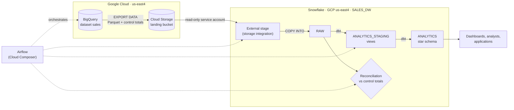

# Solution

How each part of the challenge was solved, where it is in the repository and what was verified. How to run everything is in `README.md`.

## Stack and why

| Piece | Choice | Why |
|---|---|---|
| Warehouse | Snowflake, Enterprise edition on GCP `us-east4` | The challenge is about Snowflake. Enterprise gives 90-day Time Travel and masking policies; GCP keeps the migration in section 3 inside one cloud. |
| Load | Python (`snowflake-connector-python`): `PUT` + `COPY INTO` | `PUT` of local files needs a client; `COPY INTO` is Snowflake's bulk load and remembers what it loaded. |
| Transformation and validation | dbt (`dbt-snowflake`) | Models are versioned SQL; tests, contracts, freshness and metadata live in YAML next to them. One tool covers sections 2, 4 and 6. |
| Orchestration | Airflow, standalone mode in Docker | Scheduling, retries and per-task logs come built in; one container keeps it simple locally. |
| Access | Service user `SVC_LEANTECH` with key-pair authentication | Scripts cannot use a password with MFA. The private key never leaves the machine and the role only reaches this database. Setup in `setup/snowflake_setup.sql` and `setup/generate_keys.py`. |

## 1. SQL

File: `sql/sql_exercises.sql`. It creates small temporary sample tables with the edge cases first, so it runs as-is and leaves nothing behind.

**1. Employee hierarchy.** A recursive CTE: the anchor takes each employee with their direct manager; each step climbs from the current manager to that manager's manager and stops at the CEO, who has none. Result: one row per employee and manager, with how many levels up the manager is (the CEO appears once, at 0). A level limit protects against a cycle in the data (A manages B, B manages A), which would otherwise recurse until the engine aborts. In SQL Server the same query is written `WITH` without `RECURSIVE`.
Verified: 16 rows; the deepest employee gets her four managers in order up to the CEO.

**2. Customers with orders but no payment.** `NOT EXISTS`: it stops at the first matching payment and returns each customer once. The `LEFT JOIN ... WHERE p.CustomerID IS NULL` anti-join gives the same result. `NOT IN` is avoided on purpose: a single `NULL` in `Payments.CustomerID` makes it return nothing, without an error.
Verified: `NOT EXISTS` and the anti-join return customers 102 and 103 (103 once, despite three orders); `NOT IN` returns 0 rows on the same data.

## 2. Snowflake implementation

### 2.1 Schema design
A star schema: `fact_sales` at the grain of one transaction, joined to `dim_customers`, `dim_products` and `dim_dates`. The tables are dbt models (`dbt/models/marts/`) and their structure is fixed by enforced contracts in `dbt/models/marts/_marts.yml`, so dbt creates exactly these tables and fails if a model drifts from them:

```sql
CREATE TABLE dim_customers (
    customer_id NUMBER(38,0) NOT NULL PRIMARY KEY,
    name        VARCHAR,
    email       VARCHAR,
    country     VARCHAR(3)                
);
CREATE TABLE dim_products (
    product_id   NUMBER(38,0) NOT NULL PRIMARY KEY,
    product_name VARCHAR,
    category     VARCHAR,
    price        NUMBER(12,2)
);
CREATE TABLE dim_dates (
    date_key DATE NOT NULL PRIMARY KEY,
    year     NUMBER(4,0),
    month    NUMBER(2,0),
    day      NUMBER(2,0)
);
CREATE TABLE fact_sales (
    transaction_id NUMBER(38,0) NOT NULL PRIMARY KEY,
    date_key       DATE         NOT NULL REFERENCES dim_dates (date_key),
    customer_id    NUMBER(38,0) NOT NULL REFERENCES dim_customers (customer_id),
    product_id     NUMBER(38,0) NOT NULL REFERENCES dim_products (product_id),
    amount         NUMBER(12,2) NOT NULL
);
```

- `date_key` is a real `DATE`, not a `YYYYMMDD` number: date ranges filter the fact directly, without joining `dim_dates`.

- `amount` lives on the fact: revenue does not depend on today's product price.

- Snowflake stores primary and foreign keys as metadata only. They document the model (and let tools like DBeaver draw it); the dbt `unique` and `relationships` tests are what enforce them.

- The marts are permanent tables (`+transient: false` in `dbt/dbt_project.yml`); see 2.4.

### 2.2 Data loading

The sample files were not provided, so `data/generate_samples.py` creates them (`data/customers.csv`, `data/products.csv`, `data/sales.csv`) with a fixed seed and planted problems: missing and malformed emails, the same country written 21 ways, negative, empty and non-numeric prices and amounts, impossible dates, sales for customers and products that do not exist, duplicate ids.

**Load (`pipeline/load_raw.py`).** Each file is uploaded to an internal stage (`PUT`) and loaded with `COPY INTO` into a `RAW` table where every column is `VARCHAR`, plus its source file, row number and load time. Nothing is rejected at load time, so no bad value disappears without a trace, and everything downstream can be rebuilt from `RAW`. Running it twice loads nothing the second time: `COPY INTO` skips files it already loaded. (A first version re-uploaded the files, whose new gzip bytes made `COPY INTO` load them again; the fix was `OVERWRITE = FALSE`.)

**Validation (`dbt/models/staging/stg_*.sql`).** Staging views type every column with `TRY_TO_NUMBER`, `TRY_TO_DATE` and `TRY_TO_DECIMAL`, which return `NULL` instead of failing, and mark each row; they drop nothing. The rule: reject only what makes revenue wrong, keep the rest and flag it.

| Problem | Decision |
|---|---|
| Sale with missing, non-numeric or negative amount, or missing/invalid date | Rejected |
| Sale for a customer or product that does not exist | Rejected; accepted on a later run if the customer arrives |
| Same id delivered twice | The latest delivery is kept |
| Missing or malformed email, unknown country, missing name, category or valid price | Record kept, attribute `NULL`, flagged |

**Country to ISO alpha-3.** The seed `dbt/seeds/country_iso3.csv` maps each way of writing a country, lower-cased and trimmed, to its code (`méxico` → `MEX`, `u.s.a.` → `USA`, `uk` → `GBR`). Adding a new spelling is adding a line, not changing code. Unknown names stay `NULL` and are flagged.

**Result.** `dbt/models/marts/data_quality_issues.sql` lists every rejected, flagged or dropped record with its source file and row. It found exactly the 63 problems planted by the generator:

| Source | Found |
|---|---|
| customers | 5 malformed + 5 missing emails, 3 unknown + 1 missing countries, 2 missing names, 2 duplicate ids |
| products | 2 negative + 2 missing + 1 non-numeric prices, 2 missing categories |
| sales | 10 negative + 5 non-numeric + 5 missing amounts, 4 invalid + 1 missing dates, 5 unknown customers, 5 unknown products, 3 duplicate ids |

Final tables: 200 customers, 50 products, 638 dates, 4,965 sales. The 21 country spellings became 12 ISO codes.

### 2.3 Query optimization
File: `sql/insights.sql`, run on the star schema.

- **Revenue per category** and **top 5 customers:** the fact is aggregated first, on its own keys, and the dimension joined afterwards, so the join touches one row per product or customer instead of every sale. The top 5 applies `LIMIT` before the join (5 rows reach it) and breaks ties by id, so the result is stable.

- **Monthly trend, last 12 complete months:** a plain range on `date_key` (`>= start AND < end`), with no function applied to the column, so Snowflake can skip every micro-partition outside the range (pruning). `YEAR(date_key) = ...` would force it to read them all. No join to `dim_dates` is needed.

Verified results: Toys leads with 378,514.27; 69,810.15 belongs to the two products without a category, which stays visible as "Unknown". The query profile shows 1 of 1 micro-partition read: at 5,000 sales the whole table fits in one, so the gain cannot be measured here. What matters is that the patterns hold at scale, where clustering `fact_sales` by `date_key` makes the pruning effective.

### 2.4 Snowflake features
File: `sql/snowflake_features.sql`, run on a zero-copy clone of `fact_sales` so the real tables are never touched.

- **Time Travel:** recover from a bad statement. The demo sets every amount to 0, reads the table as it was just before that statement (`BEFORE (STATEMENT => ...)`), restores that version, then drops the table and brings it back with `UNDROP`. Verified: revenue 1,451,057.28 → 0 → restored to 1,451,057.28; 4,965 rows after `UNDROP`. Retention is 1 day by default and up to 90 on Enterprise.

- **Cloning:** a copy that shares the original micro-partitions, so it is instant and costs storage only for what changes later. Uses: a development database that is a real copy of production (`CREATE DATABASE SALES_DW_DEV CLONE SALES_DW`) to test a dbt change before deploying it, or a snapshot before a risky operation.

- **Scaling compute:** a warehouse is the unit of compute and billing, charged per second while it runs.
 
  - Scale up (a bigger size) when single queries are heavy.

  - Scale out (multi-cluster, Enterprise) when many users query at once.
 
  - One warehouse per workload (loading, transformation, BI), so they never wait on each other.

  - Auto-suspend after 60 seconds idle (as `LEANTECH_WH` is set up) and resource monitors to cap monthly credits.

**Finding:** dbt creates Snowflake tables as transient by default: at most 1 day of Time Travel, no Fail-safe, and they cannot be cloned into permanent tables (the first run of this demo failed on that). The marts are now permanent (`+transient: false`), so the Time Travel the Enterprise edition pays for actually applies to them.

## 3. Cloud migration and platform design

This section is a design: there is no GCP project behind this repository, so the BigQuery and Cloud Storage commands are representative and were not executed. Everything on the Snowflake side reuses what the repository already runs.

### Direction and assumptions

**BigQuery → Cloud Storage → Snowflake.** The Snowflake account runs on GCP `us-east4`, so the landing bucket goes in the same region: the data never leaves Google's network, there is no cross-cloud egress charge and no transfer service in the path.

| Assumption | Value |
|---|---|
| Volume | ~200 GB in a BigQuery dataset `sales` (customers, products, sales); sales grows ~3 M rows a day |
| Refresh | Daily batch, source complete by 05:00 UTC |
| Security | Customer name and email are PII; the rest is internal |
| Availability | Dashboards may be read-only for up to 2 hours during cutover; BigQuery stays available for rollback |

### 3.1 Migration approach

| Phase | What happens |
|---|---|
| Discovery | Inventory tables, sizes, partitioning and schemas (`INFORMATION_SCHEMA.TABLE_STORAGE`, `COLUMNS`), find who queries them (`INFORMATION_SCHEMA.JOBS`), map types (`NUMERIC` → `NUMBER(38,9)`, `TIMESTAMP` → `TIMESTAMP_TZ`, `STRUCT`/`ARRAY` → `VARIANT`). |
| Extraction | `EXPORT DATA` from BigQuery to Parquet in GCS, one folder per table and day. Parquet keeps the types and is compressed. |
| Transfer | None: Snowflake reads the bucket directly through a storage integration. |
| Loading | External stage + `COPY INTO` the `RAW` tables, as the current load does from the internal stage. |
| Transformation | The existing dbt project: `RAW` → staging views → star schema. |
| Validation | Reconciliation against control totals exported with the data (3.3). |
| Cutover | 1) Historical backfill. 2) Parallel run: both platforms load daily and reconcile, until 5 consecutive clean days. 3) Freeze writes to BigQuery, run the last delta, pass the gate. 4) Point dashboards to Snowflake. |
| Rollback | BigQuery is not modified until decommission: rolling back is pointing dashboards back to it. It stays read-only for 30 days after cutover. |

- **Incremental loads:** customers and products are small and are exported in full every day. Sales are exported by date partition: only new days.

- **Late-arriving data:** each run re-exports the last 3 days of sales. A re-delivered transaction replaces the previous one, because staging keeps the latest delivery of each key, so late rows are added without duplicates.

- **Schema changes:** Parquet with `MATCH_BY_COLUMN_NAME` loads by column name, so a new source column does not break the load. The dbt contracts fail the build if a column used by the marts changes type, instead of producing wrong numbers.

- **Retries:** each Airflow task retries. `COPY INTO` skips files it has already loaded and each export overwrites its own day folder, so any step can run again safely.

- **Reconciliation:** every daily run compares what arrived with what BigQuery says it sent, before the marts are rebuilt.

### 3.2 Architecture and implementation



**Orchestration:** the existing DAG (`dags/sales_pipeline.py`) gets two tasks in front of it: `export_from_bigquery` (BigQuery operator running the exports below) and `reconcile` (the 3.3 query, failing the run on any mismatch). In production it runs on Cloud Composer, managed Airflow in the same project.

**GCP: bucket, exports and access**
```bash
gcloud storage buckets create gs://leantech-sales-landing --location=us-east4 --uniform-bucket-level-access

gcloud storage buckets update gs://leantech-sales-landing --lifecycle-file=delete_after_7_days.json
```
```sql
-- BigQuery: the last 3 days of sales, one folder per run day
EXPORT DATA OPTIONS (
  uri = 'gs://leantech-sales-landing/sales/dt=2026-10-12/*.parquet',
  format = 'PARQUET', overwrite = true
) AS
SELECT * FROM `sales.sales`
WHERE sale_date BETWEEN DATE_SUB('2026-10-12', INTERVAL 2 DAY) AND '2026-10-12';

-- Control totals, computed by the source over the same rows
EXPORT DATA OPTIONS (
  uri = 'gs://leantech-sales-landing/control/dt=2026-10-12/*.csv',
  format = 'CSV', header = true, overwrite = true
) AS
SELECT 'sales' AS table_name, sale_date, COUNT(*) AS row_count,
       COUNT(DISTINCT transaction_id) AS distinct_keys, SUM(amount) AS amount_sum,
       COUNTIF(customer_id IS NULL) AS null_customer_ids
FROM `sales.sales`
WHERE sale_date BETWEEN DATE_SUB('2026-10-12', INTERVAL 2 DAY) AND '2026-10-12'
GROUP BY sale_date;
```

**Snowflake: reading the bucket without keys**
```sql
CREATE STORAGE INTEGRATION GCS_SALES_LANDING
  TYPE = EXTERNAL_STAGE
  STORAGE_PROVIDER = 'GCS'
  ENABLED = TRUE
  STORAGE_ALLOWED_LOCATIONS = ('gcs://leantech-sales-landing/');

DESC STORAGE INTEGRATION GCS_SALES_LANDING;
```
```bash

gcloud storage buckets add-iam-policy-binding gs://leantech-sales-landing \
  --member="serviceAccount:<STORAGE_GCP_SERVICE_ACCOUNT>" --role="roles/storage.objectViewer"
```
```sql
CREATE STAGE RAW.GCS_LANDING
  URL = 'gcs://leantech-sales-landing/'
  STORAGE_INTEGRATION = GCS_SALES_LANDING
  FILE_FORMAT = (TYPE = PARQUET);

COPY INTO RAW.SALES
FROM @RAW.GCS_LANDING/sales/
MATCH_BY_COLUMN_NAME = CASE_INSENSITIVE
INCLUDE_METADATA = (_FILE = METADATA$FILENAME, _LOADED_AT = METADATA$START_SCAN_TIME);
```

**Security**

- **Credentials:** none are stored for the data path. The storage integration uses a service account owned by Snowflake, granted read-only access to one bucket; `STORAGE_ALLOWED_LOCATIONS` keeps it to that bucket. Airflow connects to Snowflake with the key pair of the service user, kept in Secret Manager; on Composer, Workload Identity Federation would remove that key too.

- **Network:** a Snowflake network policy accepts the service user only from Composer's egress IPs.
  ```sql
  CREATE NETWORK POLICY PIPELINE_ONLY ALLOWED_IP_LIST = ('<composer egress IPs>');
  ALTER USER SVC_LEANTECH SET NETWORK_POLICY = PIPELINE_ONLY;
  ```
- **Encryption:** TLS in transit everywhere; GCS and Snowflake encrypt at rest by default. Customer-managed keys (CMEK in GCS, Tri-Secret Secure in Snowflake) only if a policy requires them.

- **Sensitive data:** PII is masked by role, so the same query returns masked values to anyone without the `PII_READER` role.
  ```sql
  CREATE MASKING POLICY ANALYTICS.PII_MASK AS (val STRING) RETURNS STRING ->
    CASE WHEN IS_ROLE_IN_SESSION('PII_READER') THEN val ELSE '***' END;
  ALTER TABLE ANALYTICS.DIM_CUSTOMERS MODIFY COLUMN email SET MASKING POLICY ANALYTICS.PII_MASK;
  ALTER TABLE ANALYTICS.DIM_CUSTOMERS MODIFY COLUMN name  SET MASKING POLICY ANALYTICS.PII_MASK;
  ```

### 3.3 Migration validation

| Check | How | Where |
|---|---|---|
| Row counts | Per table and day, against the control totals | Reconciliation query |
| Duplicate keys | Distinct keys = rows, against the control totals; `unique` tests on the marts | Reconciliation query, dbt |
| Nulls | Nulls in required columns do not increase | Reconciliation query, dbt `not_null` |
| Aggregates | Sum of amounts per day, to the cent | Reconciliation query |
| Referential integrity | No sale without its customer or product | dbt `relationships` tests |
| Sample comparison | A random 1,000-row sample exported as-is from BigQuery, compared column by column with `EXCEPT` in both directions: 0 rows | Sample query |

```sql

WITH loaded AS (
    SELECT TRY_TO_DATE(sale_date) AS sale_date,
           COUNT(*) AS row_count,
           COUNT(DISTINCT transaction_id) AS distinct_keys,
           SUM(TRY_TO_DECIMAL(amount, 12, 2)) AS amount_sum,
           COUNT_IF(customer_id IS NULL) AS null_customer_ids
    FROM RAW.SALES
    GROUP BY 1
)
SELECT c.sale_date,
       c.row_count         = l.row_count         AS counts_match,
       c.distinct_keys     = l.distinct_keys     AS keys_match,
       c.amount_sum        = l.amount_sum        AS amounts_match,
       c.null_customer_ids = l.null_customer_ids AS nulls_match
FROM RAW.CONTROL_TOTALS c
LEFT JOIN loaded l ON l.sale_date = c.sale_date
WHERE c.table_name = 'sales';
```

**Cutover acceptance criteria** (all must hold):

1. Every reconciliation check is true for every day in scope, for 5 consecutive daily runs.

2. The sample comparison returns 0 rows in both directions.

3. `dbt build` passes with 0 errors, and `dbt source freshness` passes.

4. Rejected records in `data_quality_issues` are explained and signed off by the data owner.

5. The main dashboards show the same figures on both platforms for the last closed month.

### Trade-offs

- **Parquet over CSV:** types travel with the data and files are smaller; CSV would be easier to inspect but would need every column parsed again.

- **Daily batch over streaming (Snowpipe):** the source refreshes daily, so streaming would add cost and moving parts with no benefit. Snowpipe with GCS notifications is the next step if latency matters.

- **Storage integration over a service account key:** nothing to rotate or leak; it requires a one-time IAM grant.

- **Parallel run over a big-bang switch:** a week of double cost buys proof on real daily data, and a rollback that is only a repoint.

- **Reusing the dbt project:** the transformations already proven on the CSV load run unchanged; only the source of `RAW` changes.

## 4. Data modelling, metadata and data products

### 4.1 Modelling

Documented in `dbt/README.md`, written for someone who did not build it: the grain and key of each table, the relationships (with a diagram), naming conventions, how changes to customers, products and sales are modelled, assumptions and data quality risks. In short: customers and products are type 1 today (latest version wins); keeping history would be a dbt snapshot (SCD type 2) on customers, compared on name, email and country because the source has no update timestamp. Sales are immutable, and revenue does not move when a product price changes because the amount lives on the fact.

### 4.2 Metadata definition

In the dbt YAML files, next to the models they describe, so they cannot drift apart:

- `dbt/models/marts/_marts.yml`: `dim_customers` and `fact_sales` (9 columns) with descriptions, data types, owner, domain, sensitivity (`name` and `email` are PII), freshness SLA, and data quality rules: `not_null`, `unique`, `relationships` and `accepted_values` for the ISO country codes.

- `dbt/models/staging/_sources.yml`: freshness of the raw tables on their load time, warning after 24 hours and error after 48.

The metadata is executed, not just read: every `dbt build` runs the rules and fails on a violation, the contracts fail on a type change, and `dbt source freshness` fails when the data is stale. Verified: `dbt build` 17 of 17 passed; freshness 3 of 3 passed.

### 4.3 Data product documentation

`dbt/README.md` documents the sales data product: purpose, consumers, sources, refresh, dependencies, model, data quality, known limitations, example queries, and how to change it safely: build into a zero-copy clone first, let contracts and tests catch breaking changes, and compare `data_quality_issues` before and after.

## 5. Infrastructure as Code

Files: `terraform/main.tf`, `terraform/variables.tf`, `terraform/outputs.tf`, `terraform/.terraform.lock.hcl`.

**What it manages.** The account-level objects that `setup/snowflake_setup.sql` creates by hand: the warehouse, the database, the pipeline role, its grants and the service user with its public key. As code they are reviewed before they change and recreated identically in another environment. Only Snowflake: planning GCP resources needs a real project, which this repository does not have; the landing bucket of section 3 would be one more resource here.

**Terraform vs the pipeline.** Terraform owns what exists in the account (warehouses, databases, roles, grants, users, storage integrations, buckets and IAM). dbt owns schemas, tables and views. The pipeline owns the data. Each object has exactly one owner, so they never fight over it.

- **Variables:** account, admin user, key paths, environment and warehouse size. Account and keys come from `TF_VAR_*` environment variables, never from a file in the repository.

- **Outputs:** the names created, which are the values for `.env`.

- **Environments:** every object is prefixed with the environment (`DEV_`, `PROD_`), validated to `dev` or `prod`, and each environment has its own state.

- **State:** in a GCS bucket with versioning and locking (the backend block in `main.tf`), one prefix per environment. It is never committed (`*.tfstate` is in `.gitignore`): it describes the whole account.

- **Secrets:** the provider authenticates with a key pair read from a file path. The private key is not in the code or in the state; only the service user's public key is, which is not secret. The provider version is pinned by `.terraform.lock.hcl`.

**Plan, review, test and apply safely.**
1. A change is a pull request. CI runs `terraform fmt -check`, `terraform validate` and `terraform plan` for `dev`, and posts the plan on the pull request.
2. A reviewer reads the plan, not only the code: it lists exactly what will be created, changed or destroyed. A destroy on a database or user is a stop sign.
3. After merge, CI applies to `dev`; `prod` is applied from the same commit only after `dev` succeeds and with manual approval.
4. Objects that already exist, like the ones created by the setup script, are brought into the state with `import` blocks before the first apply, never recreated.

**Verified:** `terraform validate` passes and `terraform fmt -check` finds nothing to change. `terraform plan` against the account, with an empty state, lists 8 resources to create (`DEV_LEANTECH_WH`, `DEV_SALES_DW`, `DEV_LEANTECH_PIPELINE`, `DEV_SVC_LEANTECH` and four grants), 0 to change and 0 to destroy. It was not applied: the same objects already exist, created by the setup script.

## 6. Coding automation

Files: `dags/sales_pipeline.py`, `Dockerfile`, `docker-compose.yml`, `.dockerignore`.

**Why Airflow, and why standalone.** Airflow gives scheduling, retries and per-task logs without writing them by hand; a plain Python runner would have to re-implement all three. The usual Docker setup starts six containers (database, broker, scheduler, workers...). `airflow standalone` runs everything in one, which is enough to run the pipeline locally. In production it would run on Cloud Composer, managed Airflow on GCP.

**The DAG** runs daily, each task with 2 retries, 2 minutes apart:

```
load_raw  →  dbt_source_freshness  →  dbt_build
```

1. `load_raw` runs `pipeline/load_raw.py`.

2. `dbt_source_freshness` stops the run if the raw data is older than the rule in the YAML metadata, before transforming stale data.

3. `dbt_build` builds the models and runs the tests declared in the YAML: a broken rule fails the run.

**Design choices:**

- Airflow only orchestrates. The pipeline code runs in its own virtual environment inside the image, because dbt and Airflow pin conflicting library versions.

- Credentials are not baked into the image: `.dockerignore` sends only `requirements.txt` to the build, and `.env` and the private key are read at runtime from the mounted project folder.

**Verified:** two full runs succeeded. In the first, `dbt_source_freshness` failed and Airflow retried it on its own two minutes later, successfully. The cause was dbt's parse cache in `dbt/target/`, shared between the host and the container; dbt in the container now keeps its working files apart (`--target-path /tmp/dbt-target`). The second run passed every task on the first try, in 46 seconds.
