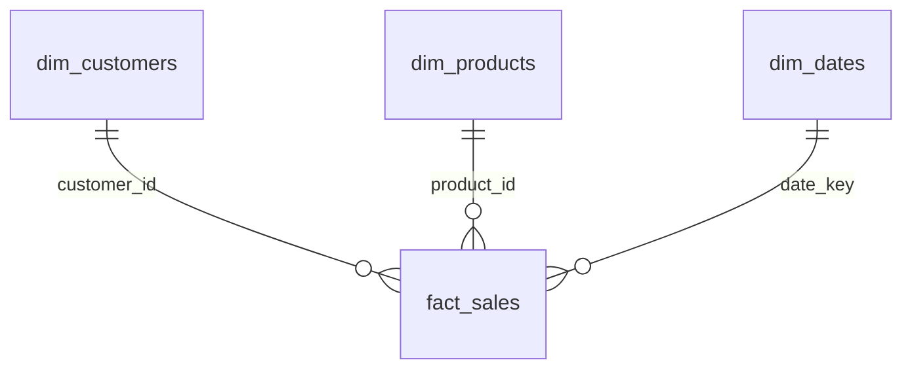

# Sales data product

Sales transactions with their customers, products and dates, as a star schema in Snowflake, validated on every load.

## Purpose and consumers

- **Purpose:** one trusted source for revenue: by product, category, customer, country and time.

- **Consumers:** analysts and BI dashboards (SQL on `SALES_DW.ANALYTICS`), and downstream applications that need customer or product attributes.

## Sources, refresh and dependencies

- **Source:** `customers.csv`, `products.csv` and `sales.csv`, loaded unchanged into `SALES_DW.RAW` by `pipeline/load_raw.py`.

- **Refresh:** each time new files are delivered, by the pipeline (load, then `dbt build`). Freshness is checked on the load time of the raw rows: warning after 24 h, error after 48 h (`dbt source freshness`).

- **Dependencies:** `RAW` → `ANALYTICS_STAGING` (views: typing and validation) → `ANALYTICS` (tables). The `country_iso3` seed maps country names to ISO codes.

## Model



| Table | Grain | Primary key |
|---|---|---|
| `fact_sales` | one sales transaction | `transaction_id` |
| `dim_customers` | one customer, latest version | `customer_id` |
| `dim_products` | one product, latest version | `product_id` |
| `dim_dates` | one calendar day, first to last sale | `date_key` |
| `data_quality_issues` | one problem found in one source record | — |

- **Keys:** `fact_sales` references the three dimensions by `customer_id`, `product_id` and `date_key`. Snowflake stores primary and foreign keys as metadata only; the `unique` and `relationships` tests enforce them on every build.

- **Measure:** `amount` is the charged amount, so it adds up correctly in any grouping.

- **Naming:** `stg_` staging views, `dim_` and `fact_` tables, snake_case, `_`-prefixed columns for load lineage (`_file`, `_row`, `_loaded_at`).

- **Column metadata** (descriptions, owner, sensitivity, freshness, rules) lives in `models/marts/_marts.yml`. `name` and `email` are PII.

## History and changes

- **Customers:** type 1 today, the latest version overwrites the previous one. If a customer moves country, "revenue by country" changes for past sales too. To keep history: a dbt snapshot (SCD type 2) on `stg_customers`, comparing name, email and country because the source has no update timestamp, and the fact joined to the version valid on the sale date.

- **Products:** a price change does not affect revenue, which comes from `amount` on each sale. A category change would need the same SCD2 treatment if reports must show the category at sale time.

- **Sales:** immutable. A sale delivered again with the same id replaces the previous delivery (the latest wins).

## Data quality

- A sale is **rejected** when its amount or date is missing or invalid, its amount is negative, or its customer or product does not exist.

- A customer or product with a bad attribute is **kept**, with that attribute NULL (missing or malformed email, unknown country, missing name, category or valid price).

- Every rejected, flagged or duplicate record is in `data_quality_issues`, with its source file and row.

- **Late data:** a sale whose customer arrives in a later file is rejected until then, and accepted automatically on the next build, because staging re-reads `RAW`.

## Known limitations

- No currency in the source: all amounts are assumed to be in one currency.

- A sale removed from the source is not removed here: the files carry no deletion signal.

- Customers with an unknown country appear under NULL in country reports; products without category under NULL.

## Example queries
```sql

SELECT 
COALESCE(c.country, 'Unknown') AS country
,SUM(f.amount) AS revenue

FROM SALES_DW.ANALYTICS.fact_sales f
    JOIN SALES_DW.ANALYTICS.dim_customers c 
        ON c.customer_id = f.customer_id
GROUP BY 1 ORDER BY revenue DESC;

SELECT 
    entity
    ,action
    ,issue
    ,COUNT(*) AS records
FROM SALES_DW.ANALYTICS.data_quality_issues
GROUP BY 1, 2, 3 ORDER BY 1, 2, 3;
```

## Changing it safely

1. Make the change in a branch and build it into a zero-copy clone, never straight into production:
   `CREATE DATABASE SALES_DW_DEV CLONE SALES_DW;` then run dbt with `SNOWFLAKE_DATABASE=SALES_DW_DEV`.

2. `dbt build` must pass: the contracts fail if a column or type changes, and the tests fail if keys or references break.

3. Compare `data_quality_issues` before and after: a jump in rejected records means the change, or the data, needs a look.

4. A new way of writing a country is a new row in `seeds/country_iso3.csv`, not a code change.

5. Never edit `RAW`: it is the record of what was received, and everything else can be rebuilt from it.
